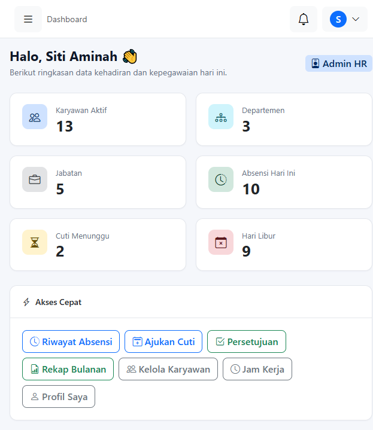
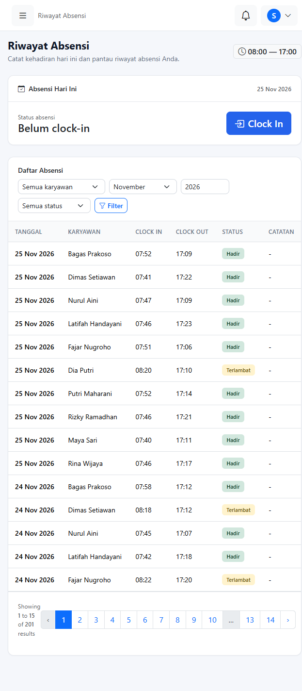
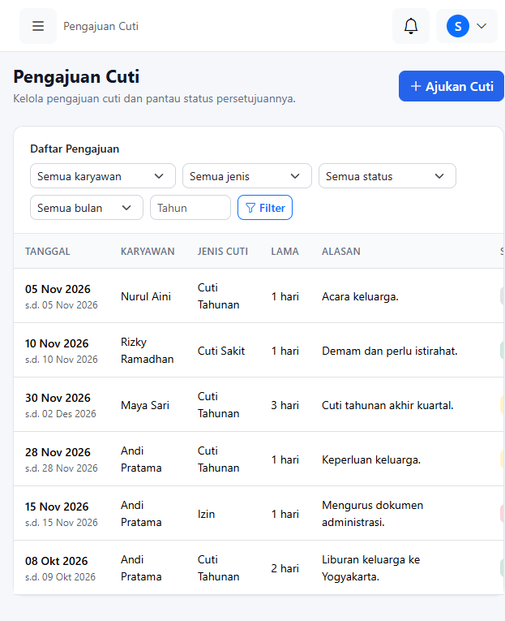
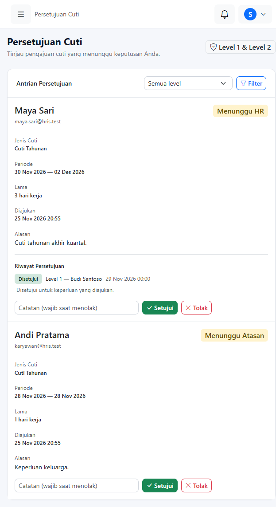
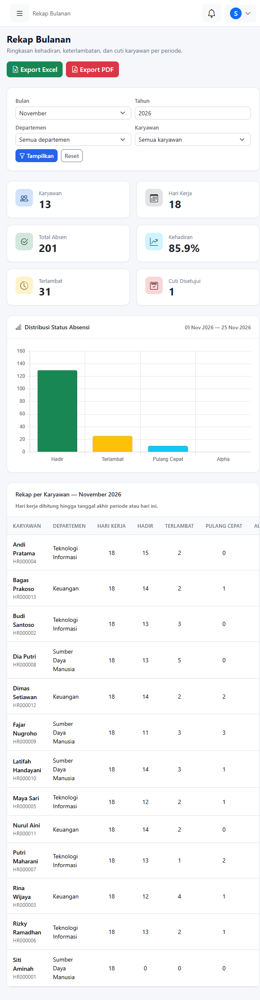
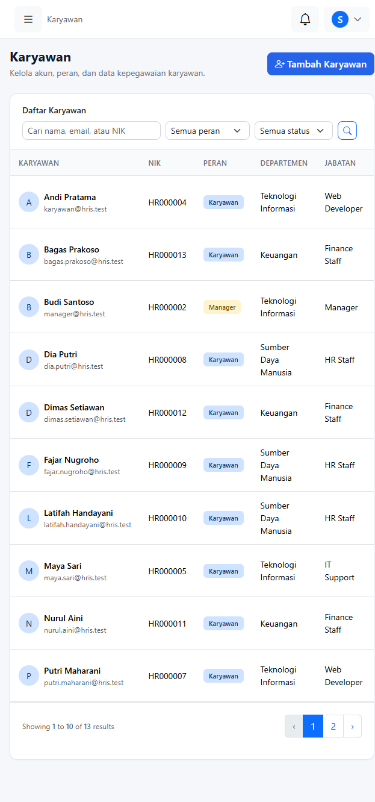
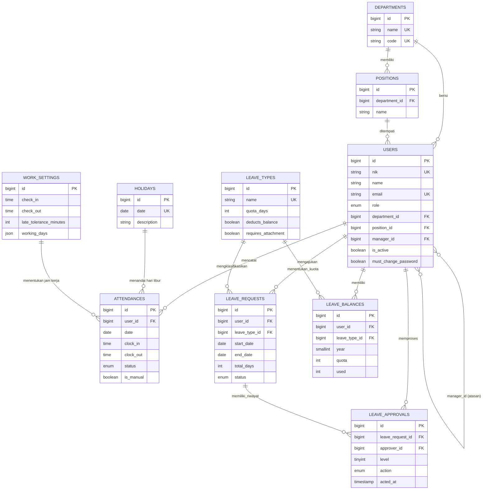
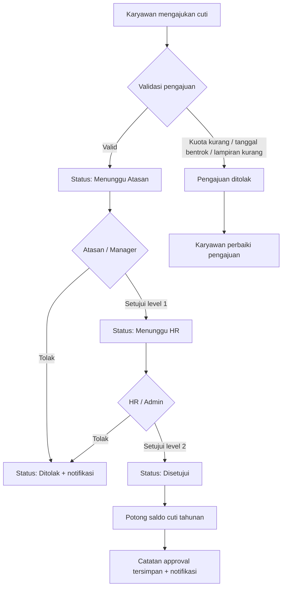

# HRIS Mini

Aplikasi demo Human Resource Information System (HRIS) berbasis Laravel 10 untuk mengelola absensi, pengajuan cuti, persetujuan dua level, dan rekap kehadiran bulanan. Seluruh antarmuka menggunakan Bahasa Indonesia dengan locale `id` dan zona waktu `Asia/Jakarta`.

## Maksud, tujuan dari pembuatan sistem ini

Sistem ini dibuat sebagai prototipe yang siap didemokan untuk menunjukkan bagaimana proses administrasi kepegawaian harian dapat dilakukan secara terdigitalisasi. Fokus utamanya adalah menyederhanakan pencatatan kehadiran, pengajuan cuti, alur persetujuan berjenjang, dan penyusunan laporan bulanan yang sebelumnya sering dilakukan secara manual.

Tujuan spesifiknya adalah:

- Menyediakan satu tempat bagi karyawan untuk melakukan clock-in/clock-out dan mengajukan cuti.
- Memberikan atasan dan HR alur persetujuan yang jelas, lengkap dengan riwayat keputusan dan notifikasi.
- Menghasilkan rekap kehadiran bulanan yang dapat diekspor ke Excel dan PDF untuk kebutuhan pelaporan.
- Menjaga integritas data melalui validasi, pembatasan hak akses per peran, transaksi database, serta audit log.
- Menjadi contoh implementasi Laravel 10 yang mengikuti praktik baik: Form Request, Policy, Service layer, eager loading, pagination, dan feature test.

## Fitur apa saja yang ada pada sistem ini

| Modul | Fitur utama |
| --- | --- |
| Autentikasi | Login, lupa kata sandi, ubah kata sandi, verifikasi email, profil, dan paksa ganti kata sandi pada akun baru. Registrasi publik dinonaktifkan; akun dibuat oleh Admin HR. |
| Dashboard | Ringkasan jumlah karyawan aktif, departemen, jabatan, hari libur, absensi hari ini, dan pengajuan cuti menunggu sesuai peran. |
| Absensi | Clock-in dan clock-out harian, pencegahan duplikat clock-in, penentuan status Hadir/Terlambat/Pulang Cepat, serta riwayat dengan filter bulan dan status. Admin/manager dapat melihat data seluruh karyawan. |
| Pengajuan cuti | Pengajuan dengan validasi tanggal, alasan, lampiran wajib untuk jenis tertentu, pengecekan sisa kuota, dan penolakan rentang tanggal yang bertabrakan. Karyawan dapat membatalkan pengajuan yang masih menunggu. |
| Persetujuan cuti | Alur dua level: atasan/manager menyetujui level 1, HR/admin menyetujui level 2. Admin dapat bertindak pada kedua level. Penolakan dan catatan approve/reject tercatat dalam `leave_approvals`. |
| Saldo cuti | Kuota per jenis cuti dan tahun dibuat otomatis. Saldo hanya dipotong setelah persetujuan akhir level 2. |
| Rekap bulanan | Rekap per karyawan dengan filter bulan, tahun, departemen, dan karyawan; kartu ringkasan; grafik Chart.js; ekspor Excel dan PDF. |
| Administrasi | CRUD karyawan, departemen, jabatan, hari libur, jenis cuti, pengaturan jam kerja, serta halaman audit log. |
| Notifikasi | Notifikasi masuk untuk pengajuan, persetujuan, penolakan, dan pembatalan; bell badge dan halaman daftar notifikasi. |
| Keamanan | Middleware `role:admin,manager` dan `role:admin`, Policy untuk tiap modul, Form Request, mass-assignment protection, soft delete, dan transaksi database. |
| Antarmuka | Bootstrap 5 responsif dengan sidebar/navbar, badge status, SweetAlert2, flash message, empty state, dan loading state. |
| Pengujian | Feature test PHPUnit untuk hari kerja, kuota kurang, konflik tanggal, approval dua level, akses admin, dan duplikat clock-in. |

Tumpuan teknologi: Laravel 10.50, PHP 8.1+, MySQL, Blade + Bootstrap 5, Chart.js CDN, SweetAlert2, maatwebsite/excel 3.1, barryvdh/laravel-dompdf 2.2, dan PHPUnit 10.

## Screenshots

Berikut tampilan antarmuka utama aplikasi menggunakan akun Admin HR pada resolusi desktop.

1. Dashboard

   

2. Riwayat absensi

   

3. Pengajuan cuti

   

4. Persetujuan cuti

   

5. Rekap bulanan dan grafik kehadiran

   

6. Administrasi karyawan

   

## Diagram sistem

### Entity Relationship Diagram (ERD)



### Alur persetujuan cuti dua level



Keterangan:

- Manager hanya dapat memproses level 1.
- Admin dapat memproses level 1 maupun level 2.
- Saldo cuti dipotong hanya ketika level 2 disetujui.
- Pembatalan hanya tersedia untuk pengajuan yang belum selesai diproses.

## Akun demo

Jalankan `php artisan migrate --seed`, lalu gunakan akun berikut. Kata sandi untuk seluruh akun adalah `password`.

| Peran | Nama | Email | Kata sandi | Akses utama |
| --- | --- | --- | --- | --- |
| Admin HR | Siti Aminah | `admin@hris.test` | `password` | Semua menu termasuk administrasi dan approval level 1/2 |
| Manager | Budi Santoso | `manager@hris.test` | `password` | Dashboard, absensi, cuti, approval level 1, rekap |
| Karyawan | Andi Pratama | `karyawan@hris.test` | `password` | Dashboard, absensi, dan pengajuan cuti sendiri |

Akun tambahan dari seeder: `rina.wijaya@hris.test`, `maya.sari@hris.test`, `rizky.ramadhan@hris.test`, `putri.maharani@hris.test`, `dia.putri@hris.test`, `fajar.nugroho@hris.test`, `latifah.handayani@hris.test`, `nurul.aini@hris.test`, `dimas.setiawan@hris.test`, dan `bagas.prakoso@hris.test`.

## Asumsi dan batasan

- Aplikasi ini ditujukan untuk demo dan pengembangan, bukan sistem produksi yang terhubung ke payroll, BPJS, atau perangkat absensi fisik.
- Jam kerja default adalah Senin–Jumat, 08:00–17:00 dengan toleransi keterlambatan 10 menit. Pengaturan dapat diubah melalui menu **Jam Kerja**.
- Hari libur pada seeder dibuat sebagai perkiraan untuk tahun berjalan berdasarkan tanggal yang diketahui, termasuk tanggal keagamaan yang dapat berubah. Admin sebaiknya memverifikasi dan memperbarui data melalui menu **Hari Libur**.
- Perhitungan hari kerja menggunakan `working_days` dan tabel `holidays`; Sabtu, Minggu, dan tanggal libur tidak dihitung sebagai hari kerja.
- Hanya jenis cuti dengan `deducts_balance = true` yang memotong saldo. Jenis cuti dengan `requires_attachment = true` wajib menyertakan berkas.
- Saldo cuti dibuat per tahun untuk setiap karyawan aktif pada saat seeding.
- Absensi menggunakan waktu server (`Asia/Jakarta`) dan menyimpan alamat IP; tidak ada validasi geolokasi atau perangkat.
- Reset kata sandi menggunakan driver `log`, sehingga tautan reset dapat dibaca dari log aplikasi saat demo.
- Lampiran disimpan di `storage/app/public` dan memerlukan `php artisan storage:link`.
- Koneksi MySQL dengan user `root` dan kata sandi kosong hanya untuk lingkungan lokal. Gunakan kredensial yang aman untuk lingkungan lain.
- Disarankan menggunakan PHP 8.1–8.3. PHP 8.5 saat ini belum kompatibel dengan versi PhpSpreadsheet yang terpasang.
- Frontend menggunakan CDN Bootstrap, Bootstrap Icons, SweetAlert2, dan Chart.js sehingga koneksi internet diperlukan saat pertama kali membuka halaman.

## Instalasi

### Persyaratan

- PHP 8.1 atau lebih baru (disarankan 8.1–8.3)
- Composer 2.x
- MySQL 5.7+ atau MariaDB 10.x
- Ekstensi PHP: `openssl`, `pdo_mysql`, `mbstring`, `xml`, `ctype`, `json`, `fileinfo`, `gd` atau `imagemagick` untuk DomPDF

### Langkah

```bash
git clone https://github.com/imanuelrpt/HRIS-SYSTEM.git
cd HRIS-SYSTEM

composer install
cp .env.example .env
php artisan key:generate
```

Buat database MySQL bernama `hris_mini`, lalu jalankan:

```bash
php artisan migrate --seed
php artisan storage:link
php artisan serve
```

Buka `http://127.0.0.1:8000` dan masuk menggunakan salah satu akun demo di atas.

> Untuk Laragon, database dapat dibuat melalui phpMyAdmin dengan nama `hris_mini`, user `root`, dan kata sandi kosong sesuai `.env.example`.

Jika konfigurasi diubah, jalankan `php artisan config:clear` sebelum `php artisan serve` atau `composer run dev`.

## Pengujian

Konfigurasi PHPUnit menggunakan MySQL database `hris_mini_test` agar perilaku migration dan query sama dengan lingkungan aplikasi. Buat database tersebut terlebih dahulu:

```bash
php artisan test
```

Jika database belum ada, buat dengan SQL berikut:

```sql
CREATE DATABASE IF NOT EXISTS hris_mini_test
  CHARACTER SET utf8mb4
  COLLATE utf8mb4_unicode_ci;
```

Cakupan feature test meliputi:

- `WorkCalendarServiceTest` — menghitung hari kerja dan mengecualikan hari libur.
- `LeaveRequestServiceTest` — menolak pengajuan saat kuota kurang dan saat tanggal bertabrakan.
- `LeaveApprovalServiceTest` — approval level 1 lalu level 2 hanya memotong saldo setelah approval HR.
- `AdminAccessTest` — karyawan dan manager tidak dapat mengakses halaman admin.
- `AttendanceAccessTest` — clock-in kedua pada hari yang sama ditolak.
- `ReportControllerTest` — akses rekap, validasi filter, dan unduhan Excel/PDF.
- Test Breeze yang disesuaikan — registrasi publik tidak tersedia dan profil menghapus akun secara soft delete.

Total saat ini: **38 test, 97 assertion**.

## Arsitektur singkat

```text
app/
├── Enums/              Status absensi, status cuti, aksi approval, dan peran
├── Exports/            MonthlyReportExport untuk Excel
├── Http/
│   ├── Controllers/    Endpoint web sesuai modul
│   ├── Requests/       Validasi dan otorisasi form
│   └── Middleware/     role: dan force-password-change
├── Models/             Eloquent model dan relasi
├── Policies/           Aturan akses per model
├── Providers/          Pendaftaran policy
└── Services/           Logika bisnis: absensi, cuti, approval, saldo, kalender, laporan
database/
├── factories/          Data uji
├── migrations/         Skema dan constraint database
└── seeders/            Master data, akun demo, dan data contoh
resources/views/        Blade + komponen UI Bootstrap
tests/Feature/          Feature test PHPUnit
```

Business logic sengaja ditempatkan di `app/Services` agar controller tetap tipis dan aturan dapat diuji secara langsung. Query daftar menggunakan eager loading dan pagination, sedangkan operasi yang mengubah beberapa tabel dibungkus transaksi database.

## Konfigurasi lingkungan (`.env.example`)

Berikut isi lengkap `.env.example` yang disertakan dalam repositori:

```dotenv
APP_NAME="HRIS Mini"
APP_ENV=local
APP_KEY=
APP_DEBUG=true
APP_URL=http://127.0.0.1:8000

APP_LOCALE=id
APP_FALLBACK_LOCALE=id
APP_FAKER_LOCALE=id_ID
APP_TIMEZONE=Asia/Jakarta

LOG_CHANNEL=stack
LOG_STACK=single
LOG_DEPRECATIONS_CHANNEL=null
LOG_LEVEL=debug

DB_CONNECTION=mysql
DB_HOST=127.0.0.1
DB_PORT=3306
DB_DATABASE=hris_mini
DB_USERNAME=root
DB_PASSWORD=

SESSION_DRIVER=file
SESSION_LIFETIME=120
SESSION_ENCRYPT=false
SESSION_PATH=/
SESSION_DOMAIN=null

BROADCAST_CONNECTION=log
FILESYSTEM_DISK=public
QUEUE_CONNECTION=sync

CACHE_STORE=file

MEMCACHED_HOST=127.0.0.1

REDIS_CLIENT=phpredis
REDIS_HOST=127.0.0.1
REDIS_PASSWORD=null
REDIS_PORT=6379

MAIL_MAILER=log
MAIL_HOST=127.0.0.1
MAIL_PORT=2525
MAIL_USERNAME=null
MAIL_PASSWORD=null
MAIL_ENCRYPTION=null
MAIL_FROM_ADDRESS="hris@hris.test"
MAIL_FROM_NAME="${APP_NAME}"

AWS_ACCESS_KEY_ID=
AWS_SECRET_ACCESS_KEY=
AWS_DEFAULT_REGION=us-east-1
AWS_BUCKET=
AWS_USE_PATH_STYLE_ENDPOINT=false
```

## Lisensi

Proyek demo ini dirilis di bawah lisensi MIT.
