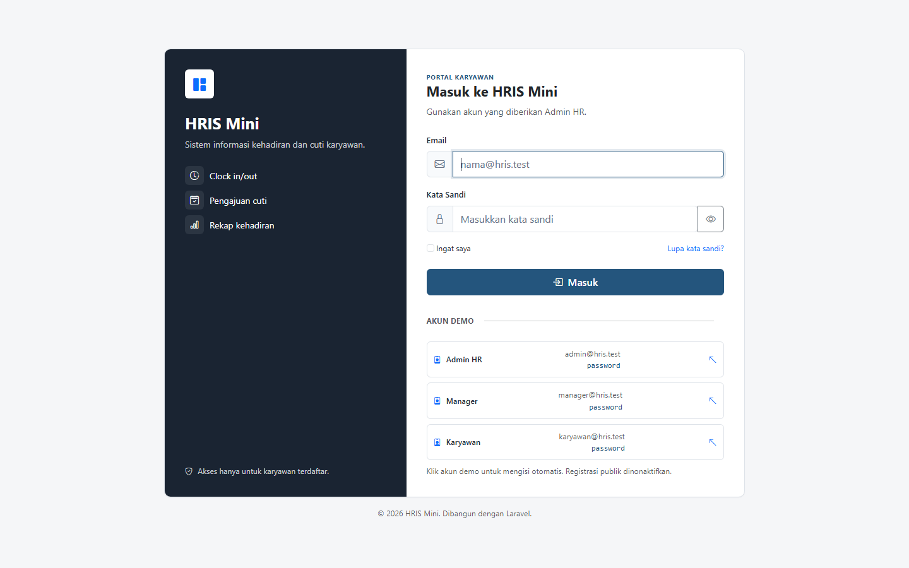
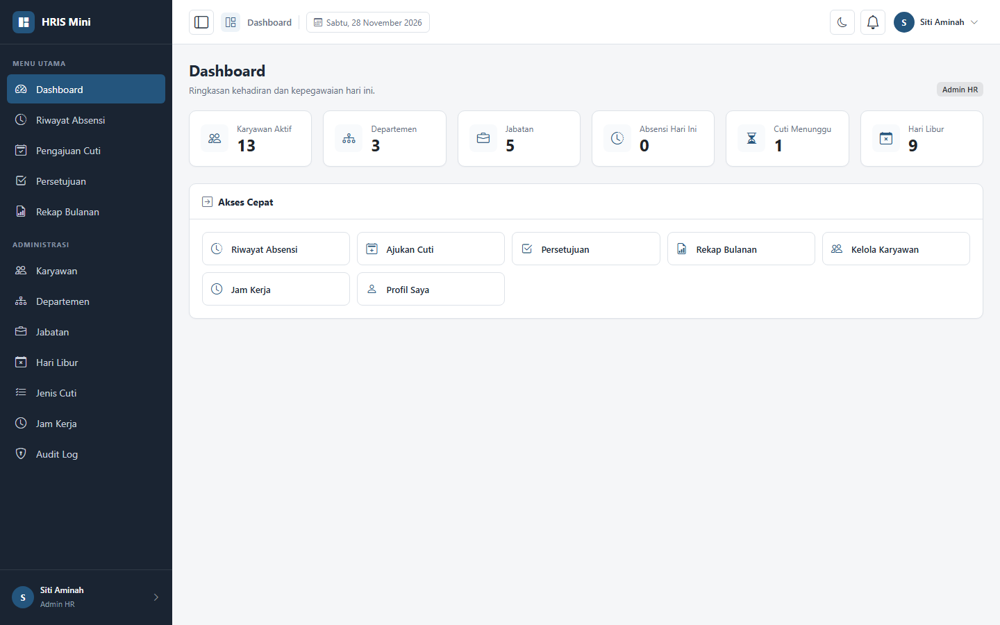
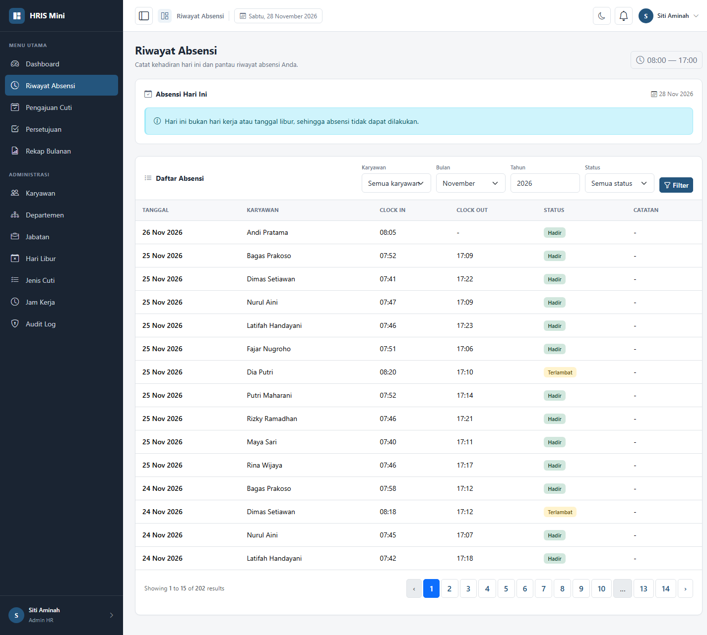
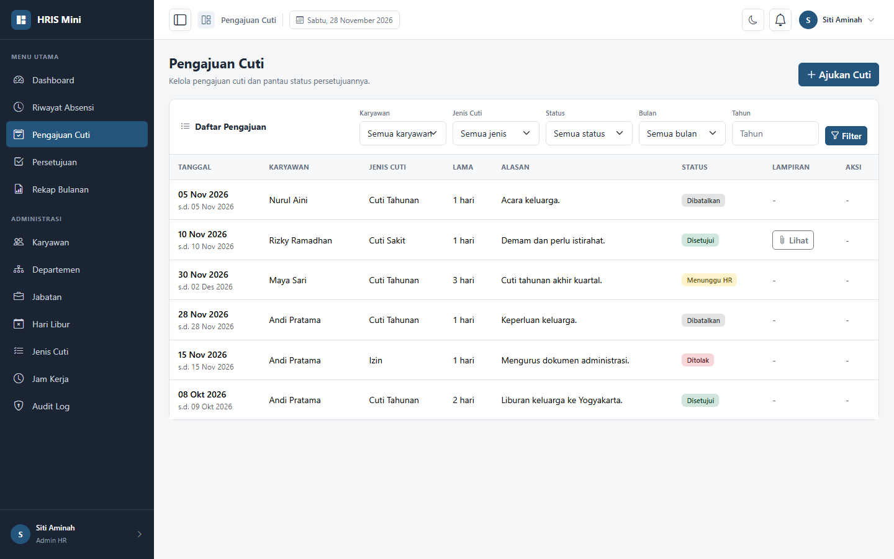
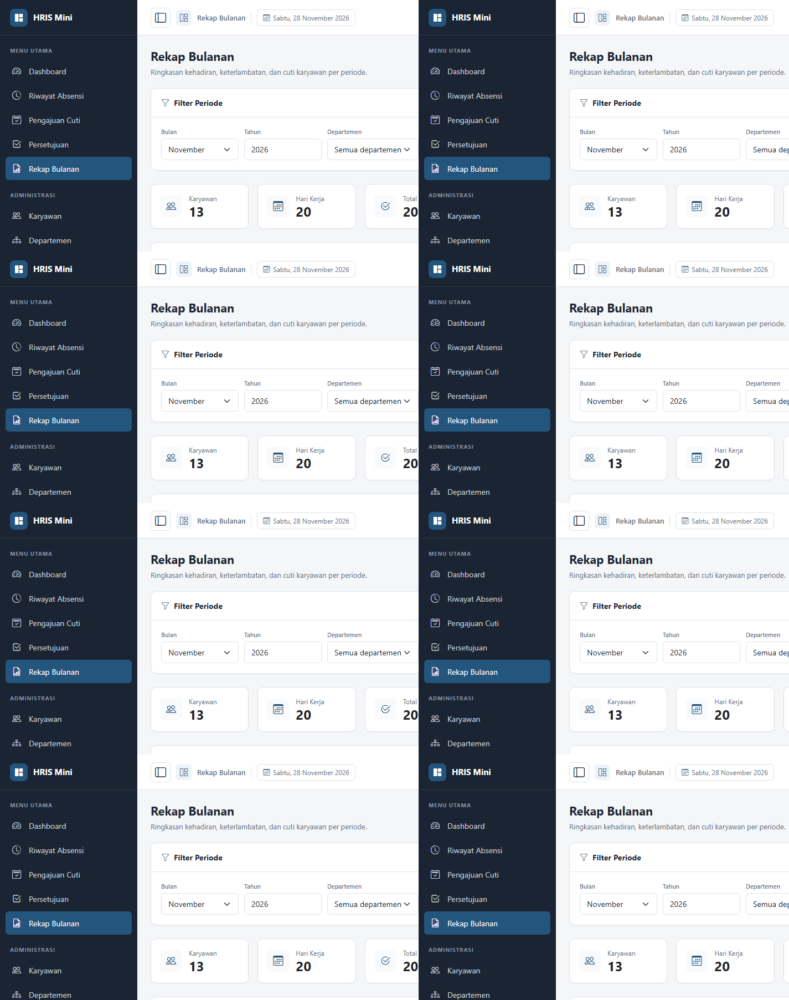
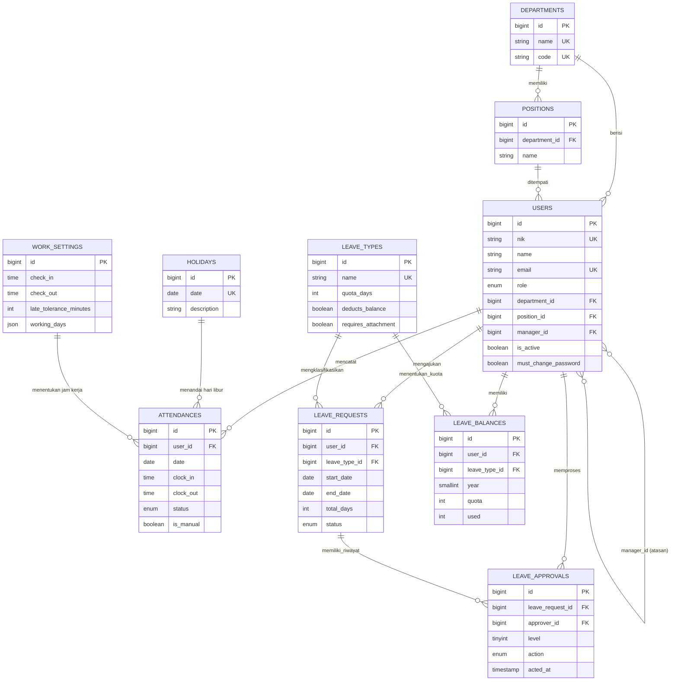
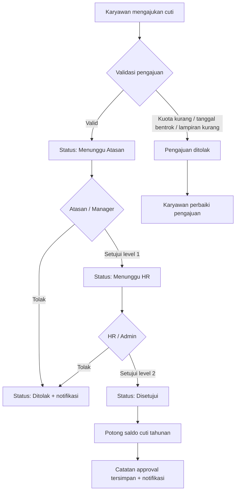

# HRIS Mini

Aplikasi demo Human Resource Information System (HRIS) berbasis Laravel 10 untuk mengelola absensi, pengajuan cuti, persetujuan dua level, dan rekap kehadiran bulanan. Seluruh antarmuka menggunakan Bahasa Indonesia dengan locale `id` dan zona waktu `Asia/Jakarta`.

## Maksud, tujuan dari pembuatan sistem ini

Sistem ini dibuat sebagai prototipe yang siap didemokan untuk menunjukkan bagaimana proses administrasi kepegawaian harian dapat dilakukan secara terdigitalisasi. Fokus utamanya adalah menyederhanakan pencatatan kehadiran, pengajuan cuti, alur persetujuan berjenjang, dan penyusunan laporan bulanan yang sebelumnya sering dilakukan secara manual.

Tujuan spesifiknya adalah:

- Menyediakan satu tempat bagi karyawan untuk melakukan clock-in/clock-out dan mengajukan cuti.
- Memberikan atasan dan HR alur persetujuan yang jelas, lengkap dengan riwayat keputusan dan notifikasi.
- Menghasilkan rekap kehadiran bulanan yang dapat diekspor ke Excel dan PDF untuk kebutuhan pelaporan.
- Menjaga integritas data melalui validasi, pembatasan hak akses per peran, transaksi database, serta audit log.
- Menjadi contoh implementasi Laravel 10 yang mengikuti praktik baik: Form Request, Policy, Service layer, eager loading, pagination, dan feature test.

## Fitur apa saja yang ada pada sistem ini

| Modul | Fitur utama |
| --- | --- |
| Autentikasi | Login, lupa kata sandi, ubah kata sandi, verifikasi email, profil, dan paksa ganti kata sandi pada akun baru. Registrasi publik dinonaktifkan; akun dibuat oleh Admin HR. |
| Dashboard | Ringkasan jumlah karyawan aktif, departemen, jabatan, hari libur, absensi hari ini, dan pengajuan cuti menunggu sesuai peran. |
| Absensi | Clock-in dan clock-out harian, pencegahan duplikat clock-in, penentuan status Hadir/Terlambat/Pulang Cepat, serta riwayat dengan filter bulan dan status. Admin/manager dapat melihat data seluruh karyawan. |
| Pengajuan cuti | Pengajuan dengan validasi tanggal, alasan, lampiran wajib untuk jenis tertentu, pengecekan sisa kuota, dan penolakan rentang tanggal yang bertabrakan. Karyawan dapat membatalkan pengajuan yang masih menunggu. |
| Persetujuan cuti | Alur dua level: atasan/manager menyetujui level 1, HR/admin menyetujui level 2. Admin dapat bertindak pada kedua level. Penolakan dan catatan approve/reject tercatat dalam `leave_approvals`. |
| Saldo cuti | Kuota per jenis cuti dan tahun dibuat otomatis. Saldo hanya dipotong setelah persetujuan akhir level 2. |
| Rekap bulanan | Rekap per karyawan dengan filter bulan, tahun, departemen, dan karyawan; kartu ringkasan; grafik Chart.js; ekspor Excel dan PDF. |
| Administrasi | CRUD karyawan, departemen, jabatan, hari libur, jenis cuti, pengaturan jam kerja, serta halaman audit log. |
| Notifikasi | Notifikasi masuk untuk pengajuan, persetujuan, penolakan, dan pembatalan; bell badge dan halaman daftar notifikasi. |
| Keamanan | Middleware `role:admin,manager` dan `role:admin`, Policy untuk tiap modul, Form Request, mass-assignment protection, soft delete, dan transaksi database. |
| Antarmuka | Bootstrap 5 responsif dengan sidebar/navbar, badge status, SweetAlert2, flash message, empty state, dan loading state. Tampilan diperbarui dengan sistem desain kartu, mode terang/gelap, akses cepat, filter terstruktur, autofill akun demo, dan toggle kata sandi. |
| Pengujian | Feature test PHPUnit untuk hari kerja, kuota kurang, konflik tanggal, approval dua level, akses admin, dan duplikat clock-in. |

Tumpuan teknologi: Laravel 10.50, PHP 8.1+, MySQL, Blade + Bootstrap 5, Chart.js CDN, SweetAlert2, maatwebsite/excel 3.1, barryvdh/laravel-dompdf 2.2, dan PHPUnit 10.

## Screenshots

Berikut tampilan antarmuka utama aplikasi dengan desain sederhana: palet netral, satu warna aksen, dan tanpa dekorasi berlebih. Halaman selain login menggunakan akun Admin HR pada tampilan desktop lebar 1440px.

1. Halaman masuk dengan akun demo dan toggle kata sandi

   

2. Dashboard

   

3. Riwayat absensi

   

4. Pengajuan cuti

   

5. Persetujuan cuti

   

6. Rekap bulanan dan grafik kehadiran

   

7. Administrasi karyawan

   

## Diagram sistem

### Entity Relationship Diagram (ERD)

### Alur persetujuan cuti dua level

Keterangan:

- Manager hanya dapat memproses level 1.
- Admin dapat memproses level 1 maupun level 2.
- Saldo cuti dipotong hanya ketika level 2 disetujui.
- Pembatalan hanya tersedia untuk pengajuan yang belum selesai diproses.
